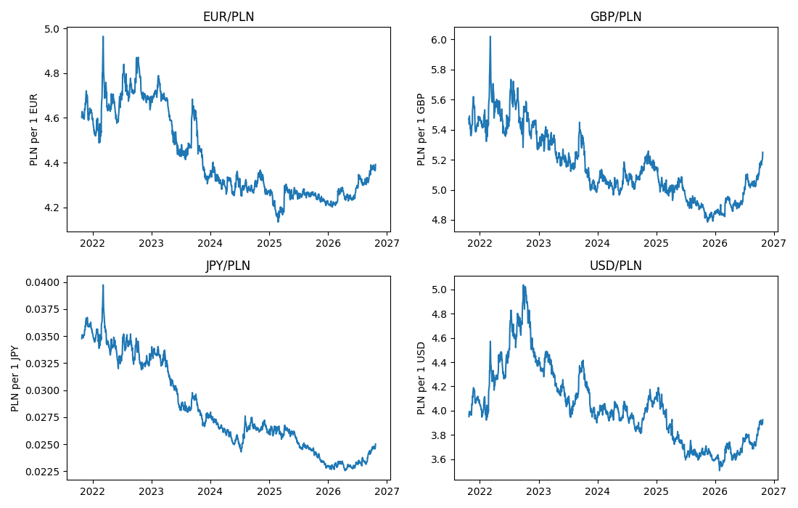
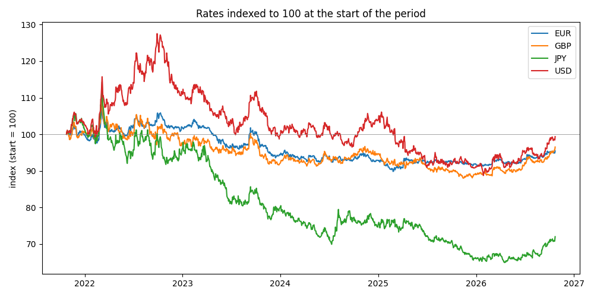

# PLN exchange rate analysis

Downloads 5 years of official NBP exchange rates for EUR, USD, GBP and JPY
against the Polish zloty, analyses them and plots them.

Data: NBP Web API, table A (average rates), https://api.nbp.pl/en.html

## How to run

```
python -m venv .venv
.venv\Scripts\activate        (Mac/Linux: source .venv/bin/activate)
pip install -r requirements.txt
python -m pln_rates.main --end-date 2026-10-23
python -m pytest
```

`--end-date` is optional. Without it the script uses the latest published day.
Results are written to `data/rates.csv` and `outputs/`.

## Files

- `pln_rates/fetch.py` - downloads the rates (split into windows, retries, error handling)
- `pln_rates/analysis.py` - daily changes, lowest/highest, biggest moves
- `pln_rates/plots.py` - the charts
- `pln_rates/main.py` - runs everything
- `tests/` - tests (no network needed, the API is mocked)

## Assumptions

- Rates are NBP table A, `mid` value, in PLN per 1 unit of the foreign currency
  (checked: GBP is about 5, JPY is per 1 yen, about 0.025).
- A falling rate means the foreign currency lost value against the zloty.
- NBP only allows 93 days per request, so the 5 years are downloaded in windows.
  Windows do not overlap, and duplicate dates are dropped anyway.
- There are no rates on weekends and Polish holidays. "One day" means one
  published day to the next published day.
- Biggest one-day moves are ranked by percent change, because JPY (about 0.025)
  and GBP (about 5) cannot be compared in PLN. The PLN change is shown too.
- The question about "highest depreciation / appreciation" is read as the
  lowest / highest rate in the period. Biggest one-day depreciation / appreciation
  is read as the biggest one-day fall / rise.
- If two days tie, the earliest is reported.
- Table A comes out between 11:45 and 12:15 Warsaw time. Before 12:15 the default
  end date is yesterday.
- 5 years = 365 * 5 days back from the end date.
- A 404 from the API means no data in that window (weekend, not published yet),
  so it is skipped. A 400 means our request is wrong, so the script stops.
  Timeouts and 5xx errors are retried 3 times.

## Results (2021-10-24 to 2026-10-23)

| Currency | Lowest | Highest | Biggest one-day fall | Biggest one-day rise |
|---|---|---|---|---|
| EUR | 4.1339 (2025-02-25) | 4.9647 (2022-03-07) | -1.43% (2022-02-15) | +2.65% (2022-03-07) |
| GBP | 4.7854 (2025-11-14) | 6.0211 (2022-03-07) | -3.13% (2022-09-26) | +3.08% (2022-03-07) |
| JPY | 0.022566 (2026-04-17) | 0.039735 (2022-03-07) | -3.22% (2022-03-28) | +4.44% (2022-03-07) |
| USD | 3.5045 (2026-01-28) | 5.0381 (2022-09-28) | -4.11% (2022-11-14) | +4.13% (2022-03-07) |

The date of a fall or rise is the day the move happened, compared with the
previous published day. Full table: `outputs/answers.csv`.

All four currencies had their biggest one-day rise on 2022-03-07, when the
zloty weakened sharply after the invasion of Ukraine.




## What I would add for production

- run it on a schedule, after 12:15 Warsaw time
- load only new days instead of all 5 years every time
- store in a proper platform (for example Delta tables on Databricks) instead of CSV
- alerting on failures and data quality checks
- CI/CD pipeline
- making the plots more interactive
